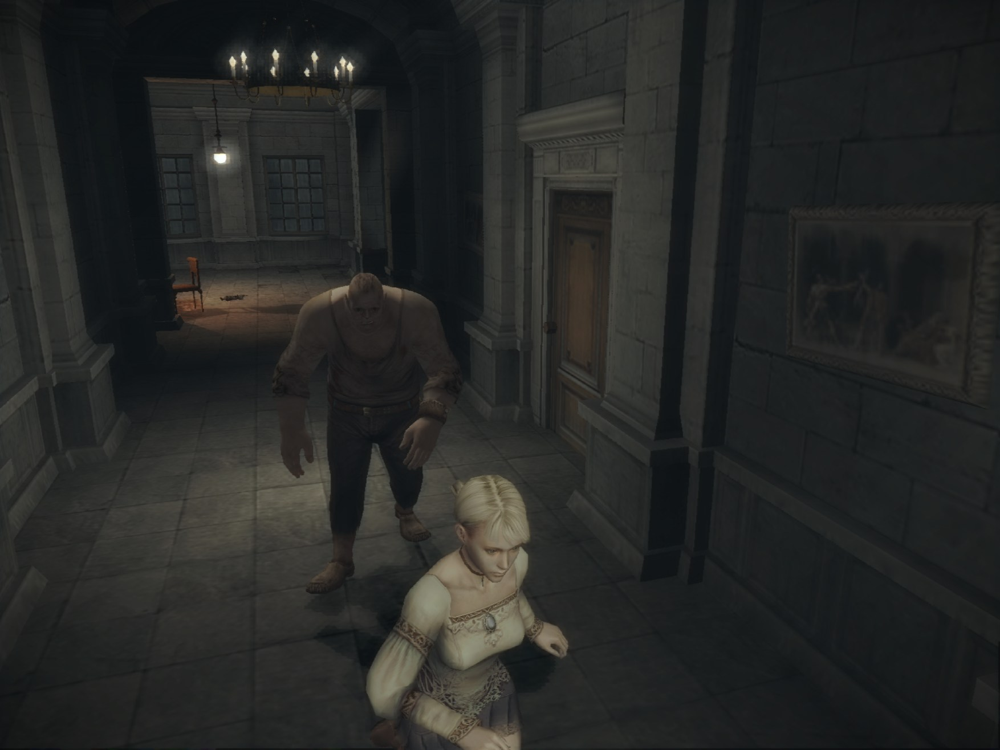
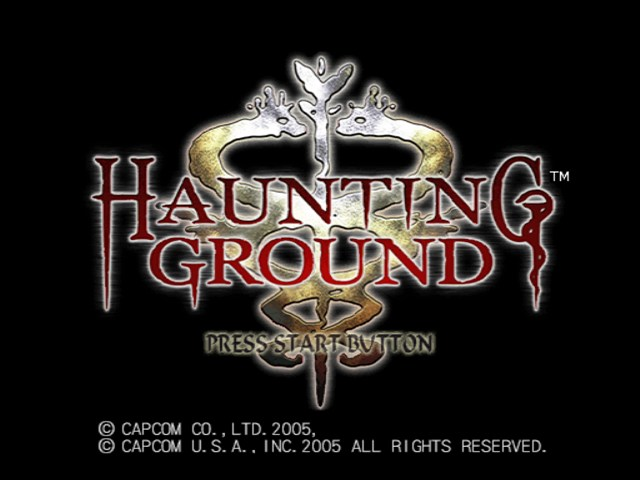
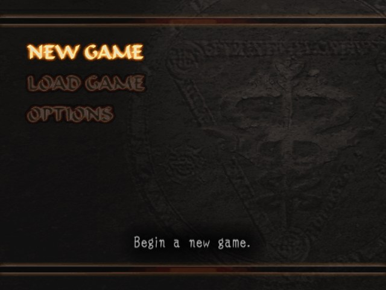
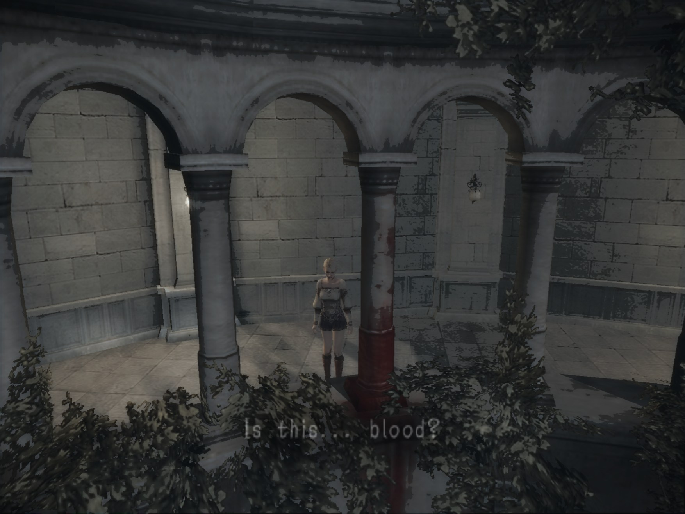
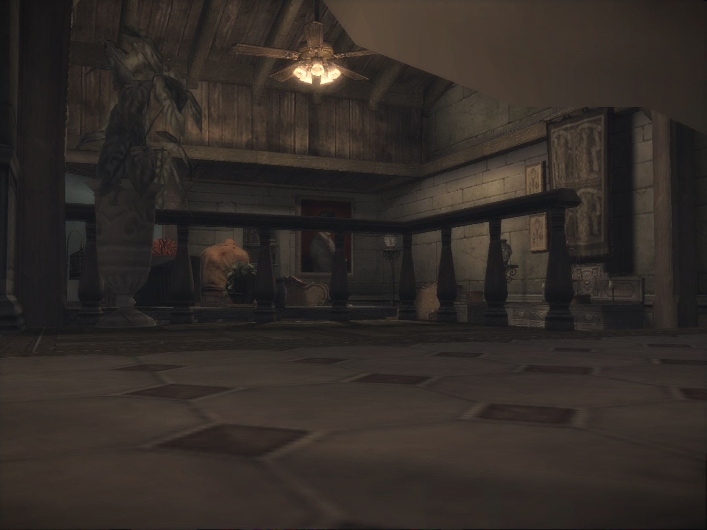
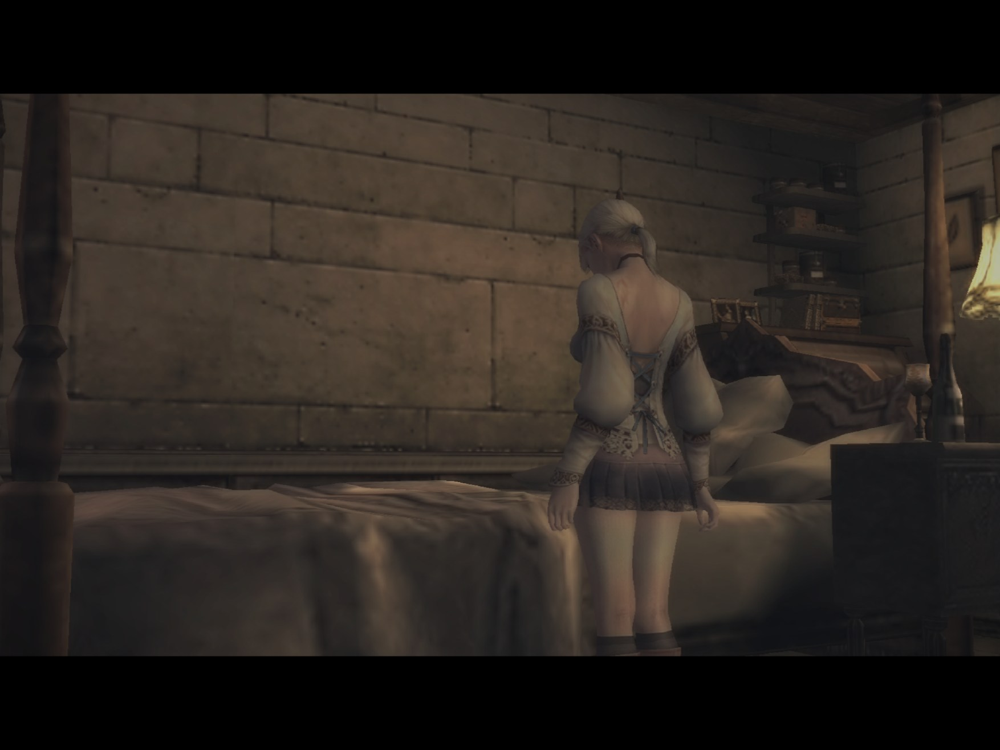
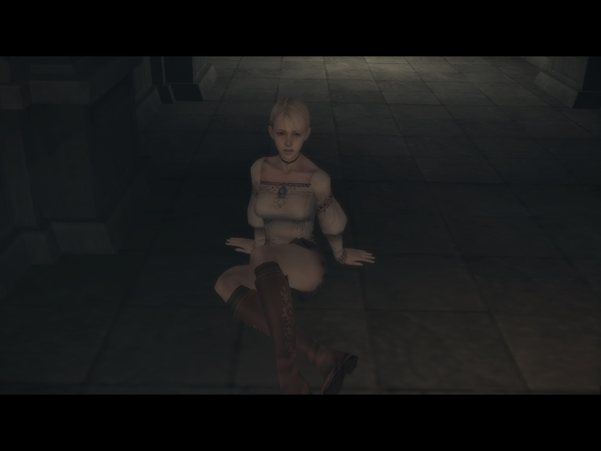
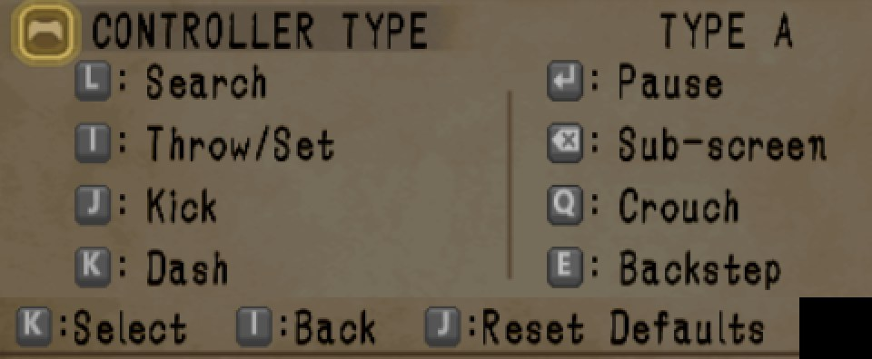

# Haunting Ground Recompiled

**Haunting Ground (PS2, 2005) running natively on PC. Not an emulator: the game's own code, rebuilt as a Windows program.**

> [!WARNING]
> **Work in progress.** Tested from the start of the game into the early castle areas, played side by side with the
> original game on a real PlayStation 2 (the tester's own console and disc).
> The later parts of the game, the endings, saving and loading, and Hewie's commands have not been tested yet. Expect
> bugs, and please report them (see [Reporting bugs](#reporting-bugs)).



You need your own copy of the game (Haunting Ground, USA version, SLUS-21075). **No game files are included here.**

Haunting Ground was released by Capcom on the PS2 only. This project turns the game's own PS2 code into a Windows
program with [PS2Recomp](https://github.com/ran-j/PS2Recomp) (static recompilation).

---

## Progress (last updated October 19, 2026)

**How it is tested:** the port is played side by side with the original game running on a real PlayStation 2 (the
tester's own console and disc), so the PC version can be checked against the real thing.

How far the game has been played on this port so far (several sessions on October 18 and 19, 2026, up to about 16
minutes each):

| Part of the game | Status |
|------------------|--------|
| Capcom logo, opening movie, title screen, main menu | ✅ Played |
| NEW GAME and the opening | ✅ Played |
| The first outdoor areas (the wooded path, the courtyard) | ✅ Played |
| The castle: the stair hall, the hall where Debilitas appears, a bedroom | ✅ Played |
| Everything after the early castle areas (later chapters) | ⬜ Not played yet |
| Endings and credits | ⬜ Not played yet |

| Game feature | Status |
|--------------|--------|
| Exploring the areas | ✅ Works |
| Hiding (under a bed) | ✅ Works |
| Debilitas (in the hall where he appears) | ✅ Works |
| Story cutscenes | ✅ Works |
| Movies | ✅ Works |
| Sound in cutscenes | 🔧 Short dropouts in some cutscenes, being fixed |
| Button prompts that show your PC keys | ✅ Works |
| Bug snapshots (F8) | ✅ Works |
| Saving and loading (memory card) | ⬜ Not tested yet |
| Hewie (the dog) and his commands | ⬜ Not tested yet |
| Corner darkening (vignette) at 2K | 🔧 Looks stepped, being fixed |

---

## What works

- **The game itself:** from the opening through the first outdoor areas and into the castle: exploring, hiding under
  a bed, Debilitas in the hall, story cutscenes and movies.
- **2K:** `Start-Haunting-Ground-2K.cmd` renders at 3x the original resolution (1920x1344 for the game's 640x448
  picture), shown in the original 4:3 in a maximized window. In test runs the first room runs at full speed (about 60
  fields per second) at 2K on a modern graphics card.
- **Windowed or full screen** (F11).
- **Keyboard, mouse and controllers**, all rebindable in game with **F1**.
- **Button prompts show your keys:** if "Search" is on the L key, the game shows "L" instead of the PS2 circle (see
  [Controls](#controls)). With an Xbox-style controller they are meant to show A, B, X, Y, LB, RB, LT, RT, View and
  Menu, with a PlayStation controller the original icons (the controller art is not checked in play yet).
- **Bug recorder:** press **F8** right after something looks or sounds wrong, and a snapshot of the last seconds is
  saved (see [Reporting bugs](#reporting-bugs)).
- **Japanese-style hiding notices (optional):** like the Japanese release (Demento), without the "Hiding..." and "Coast
  Clear" notices (see [Options](#options)).

## Known issues

- **Short sound dropouts in some cutscenes.** Being fixed.
- **Stepped corner darkening at 2K:** the game darkens the corners of the screen (a vignette). At 2K the darkening
  looks stepped/banded instead of smooth. Being fixed.
- **Graphics lag at 2K after a fresh start:** for about the first 30 seconds after you first get control, the
  graphics can lag. Being investigated.
- **First start is slow:** the graphics are prepared for your graphics card the first time. Later starts are faster.
- **Short pauses the first time an effect appears**, while its graphics are prepared. They do not come back once seen.
- **Black flashes:** short black flashes of the screen were seen in early sessions. The cause found is fixed
  (October 19). If you still see one, press F8 (the recorder also saves a snapshot of a black flash by itself).
- **A thin darker strip at the left edge of the picture** was seen in one cutscene at 2K. Not explained yet.
- **Not tested yet:** saving and loading, Hewie's commands, the later chapters and the endings. They may crash or
  misbehave.

Not bugs: when the opening movie is skipped, the title screen is silent (the game's own code only plays the title
sound when the movie was not skipped). The short black moment between the CRI and Dolby logos at boot is the game's
own transition.

---

## Screenshots

All captured from this port running on PC (title screen and menu at the original resolution, the rest at 2K).

| | |
|---|---|
|  |  |
| Title screen | Main menu |
|  |  |
| The courtyard: "Is this... blood?" | Hiding under a bed, looking out into the hall |
|  |  |
| Bedroom cutscene | Cutscene close-up |

---

## How to set it up

### What you need

1. **Windows 10 or 11** and a reasonably modern graphics card.
2. **Visual Studio 2022** (or the Build Tools) with the x64 C++ tools ("Desktop development with C++"; CMake and
   Ninja come with it).
3. **Python 3.10 or newer** and **git**.
4. **Your own Haunting Ground (USA) disc image** (`.iso`, serial SLUS-21075). Check it against
   [DISC_HASHES.md](DISC_HASHES.md): the game's boot file must match, or the port refuses to start.

### Build it

Open a terminal (PowerShell) and run these one at a time:

```powershell
git clone https://github.com/LasVola/hauntingground-recomp.git
cd hauntingground-recomp
copy "<path to your copy>\Haunting Ground (USA).iso" game\
python -I build.py generate    # builds the recompiler, then recompiles SLUS_210.75 from your disc into generated\
python -I build.py configure   # CMake + Ninja; downloads raylib, imgui and rlImGui on the first configure
python -I build.py build       # build\port\bin\hauntingground.exe
```

- Instead of copying the image into `game\`, you can pass `--iso <your image>` to `generate`, set `HG_ISO`, or set
  `[Game] Iso=` in `hauntingground.ini`.
- The full build compiles over 11,000 generated files and needed close to 30 GB of RAM with many compilers running at
  once. Set `HG_JOBS=8` (or lower) to run fewer.
- 3D scenes need the VU1 programs compiled ahead of time for full speed. Without them they run slowly (see
  [Faster 3D](#faster-3d-vu1-programs)).

### Play

Double-click **`Start-Haunting-Ground-2K.cmd`** (2K, maximized window) or **`Start-Haunting-Ground.cmd`** (original
resolution, small window). `python -I build.py run` works too. Remember the first start is slow (see
[Known issues](#known-issues)). To quit, close the window.

- Your saves: `build\port\bin\memcards\`. The first time you save, the game may ask to format the new, empty memory
  card.
- Your control settings: `build\port\bin\controls.ini`.
- Your settings: `build\port\bin\hauntingground.ini` (written on the first start, see [Options](#options)).
- The log of the last session: `build\port\bin\logs\play_last.log` (the one before is kept as `play_<time>.log`).

---

## Controls

Press **F1** in game (or **Back + Start** on a controller) to change any key or button. Changes are saved to
`controls.ini` and work right away.



The action names below are the ones the game's own OPTIONS screen shows (controller type A).

| Action | Keyboard | Controller |
|--------|----------|------------|
| Move | W A S D | Left stick |
| Dash / OK | K | A (Cross) |
| Search / examine | L | B (Circle) |
| Kick | J | X (Square) |
| Throw/Set / back | I | Y (Triangle) |
| Crouch | Q | LB (L1) |
| Backstep | E | RB (R1) |
| L2 / R2 (no action named yet) | 1 / 3 | LT / RT |
| Hewie: go / attack | T | Right stick up |
| Hewie: come back | G | Right stick down |
| Hewie: scold | F | Right stick left |
| Hewie: praise / tend | H | Right stick right |
| Hewie: stay / come | V | R3 (right stick click) |
| L3 (no action named yet) | C | L3 (left stick click) |
| Pause | Enter | Start |
| Sub-screen (menu) | Backspace | Back (Select) |
| Menus | Arrow keys | D-pad |

The Hewie rows are the names on this port's Controls screen (F1). They have not been checked in play yet.

To skip a movie, press Start (this pauses it), then Triangle.

| Key | What it does |
|-----|--------------|
| F1 | Controls screen |
| F3 | Frame rate on screen on / off |
| F8 | Save a bug snapshot (see [Reporting bugs](#reporting-bugs)) |
| F11 | Full screen on / off |
| F12 | Developer debugger |
| F5 / F9 | Save state / load state (not tested yet; use the game's own saves) |

## Options

Settings are in `build\port\bin\hauntingground.ini` (next to `hauntingground.exe`, written with the defaults on the
first start). Edit it with the game closed.

| Setting | What it does |
|---------|--------------|
| `[Game] HideHidingPrompts=1` | Japanese-style hiding notices, like Demento: no "Hiding..." and "Coast Clear" notices. "Flee!" and "Status Restored" stay. Default `0` = the US game's notices. |
| `[Game] Iso=` | Your disc image, if it is not in `game\`. |
| `[Video] InternalResolution=` | 1 = original resolution, 2 to 8 = that many times sharper (3 = 2K). The 2K launcher uses 3 for its own start without changing this file. |
| `[Video] StartFullscreen=1` | `Start-Haunting-Ground.cmd` starts in borderless full screen (F11 switches back). The 2K launcher always starts in a maximized window: press F11 there. |

Environment switches (set them in the console before a launcher): `HG_PROMPTS=0` shows the original PS2 button icons
instead of your keys, `HG_BUG_RECORDER=0` turns the bug recorder off.

---

## Troubleshooting

| Problem | What to do |
|---------|------------|
| The port refuses your disc image | Your image is a different version. Compare it with [DISC_HASHES.md](DISC_HASHES.md). |
| The very first start is slow | Wait: the graphics are being prepared. Later starts are faster. |
| 3D scenes run slowly | See [Faster 3D](#faster-3d-vu1-programs) below. |
| No window appears and the game stops after 2 minutes | You started `hauntingground.exe` directly: its default settings are for hidden test runs (`Headless=1`, `TimeLimitSeconds=120`). Use a `Start-Haunting-Ground*.cmd` launcher or `python -I build.py run`. |
| The game crashes or freezes | Please report it with the log file (next section). |

## Reporting bugs

Open an issue, say where in the game it happened, and attach the log of your last session:
`build\port\bin\logs\play_last.log` (the session before that is kept as `logs\play_<time>.log`).

For a picture or sound problem, press **F8** right after it. A message shows the folder of the bug snapshot:
`build\port\bin\logs\bugshots\<time>_<field>\`. Attach its `contact.png` (the last 48 frames, black ones framed red).
The large `gs.gsr` file next to it is a recording of the graphics commands and holds the game's own graphics data, so
please do not post it publicly. A black flash saves a snapshot by itself (at most one per 30 s and 20 per session).

A snapshot at 2K takes about 350 MB (F8) or 175 MB (automatic) of disk; below 8 GB free no `gs.gsr` is written,
below 2 GB only a text file. Delete old snapshot folders when you no longer need them.

---

## For developers

### Faster 3D (VU1 programs)

Some 3D effects run on the PS2's VU1 coprocessor. For full speed they are compiled ahead of time:

1. Play once with `PS2X_VU1_CAPTURE=<full path of an empty folder>` set in the same console, for example
   `set PS2X_VU1_CAPTURE=C:\hg-vu1` and then `Start-Haunting-Ground.cmd`. Later, any program that is still not
   compiled is logged as `[vu1-aot] image ... has no compiled code` and saved as `vu1_<hash>.bin` in
   `build\port\bin\logs\vu1_missing\`. Copy those files into the same folder.
2. Build `vu1_recomp`: `python -I build.py configure -DHG_BUILD_TOOLS=ON`, then `python -I build.py build vu1_recomp`.
3. Run `build\port\runtime\ps2xTest\vu1_recomp.exe <that folder> generated\vu1`, then `python -I build.py build`.

Without these steps VU1 runs in the interpreter, which makes 3D scenes slow (the first room ran at about 14 fields
per second instead of 60). The first room used 36 VU1 code images; the author's current build has more, including
the ones met so far in play.

How a VU1 program is run (Haunting Ground's default, `PS2X_VU1_CONTENT_AOT=2`): whole-image compiled code first (the
fast path above); where an image has none, a content-keyed compiled unit for the exact program bytes, if one was
built; the interpreter last. A whole-image miss is still logged and saved to `vu1_missing`. `PS2X_VU1_CONTENT_AOT=1`
tries content units first (exact but about three times the VU1 cost), `0` uses whole-image code only. The
content-keyed units are made with `vu1_recomp --content <inputs> generated\vu1` from input files that a development
tool outside this repository produces, so a fresh clone has only the whole-image path and the interpreter.
`[vu1-lookup]` lines in the log (with `PS2X_PACING_STATS=1`, set by both launchers) count which path ran.

These are the steps used during development. A build from a completely fresh clone has not been tried yet.

### Other commands

- `python -I build.py status` shows what exists so far.
- `python -I build.py boot --seconds 120` runs the game once, hidden and muted, with a time limit. The output goes to
  `build\port\bin\logs`.

### How it works

- **The main program** (`SLUS_210.75`, all 11,452 functions, no stubs) is recompiled to C++. The disc's ELF has one
  section that holds code and data together. `recomp/hauntingground_sections.csv` splits it, so that only real code is
  translated. `build.py generate` gives the recompiler a copy with those section headers, while the runtime loads the
  disc's own ELF unchanged.
- **Function boundaries and names** (`recomp/hauntingground_functions.csv`) come from the
  [OpenHuey](https://github.com/ArnautDaniel/OpenHuey) decompilation's symbols plus the PS2 SDK entry points.
- **SDK functions** are bound by address to runtime handlers (`src/hg/hle_bindings.cpp`). Haunting Ground loads no
  code at run time, so there are no overlays.
- **Runtime fixes made for this game:**
  - EE: the kernel stack top for `SetupThread`;
  - IOP: alarms (`SetAlarm`), RPC binding before the server is up, sysclib `strtol`/ctype, file I/O, `sceCdSearchFile`
    on the real disc image, and module placement through the IOP allocator;
  - recompiler: the `PMFHL` instruction variants;
  - module loading: `sceSifLoadStartModule` returns the module's real start result;
  - GS: shadow-volume edges and texture sampling at the screen and buffer edges above 1x internal resolution; the
    picture is taken at the vertical blank in GS command order, so a frame between the game's clear of the display
    buffer and its copy into it is never shown (`PS2X_PRESENT_AT_VBLANK=0` restores the old path); a recording ring
    for the bug recorder (`gs_recording`, `gs_threaded_backend`);
  - VU1: the content-keyed compiled units and the hybrid lookup (`ps2_vu1_core.cpp`, `ps2_vu1_content.h`,
    `vu1_recomp --content`);
  - memory card: a failed host write is reported to the game as failed;
  - audio: the two debug dumps have separate switches (`PS2X_AUDIO_DUMP` = SPU2 output, `PS2X_AUDIO_BACKEND_DUMP` =
    the audio backend's WAV).

  Each change is commented where it is made.
- **Port-side features:** the PC-key button prompts (`src/hg/button_prompts`, `prompt_cells`, `prompt_art`) redraw
  the ten button icons of the game's small font in guest RAM after checking that the font is the disc's own; the
  optional Japanese-style hiding notices are `src/hg/hiding_prompts`; the bug recorder is
  `runtime/ps2xRuntime/src/lib/ps2_bug_recorder.cpp`.

---

## Credits and legal

- [PS2Recomp](https://github.com/ran-j/PS2Recomp) by ran-j and contributors: the recompiler and runtime.
- [LightVelox](https://github.com/LightVelox): the [sotc-port fork of PS2Recomp](https://github.com/LightVelox/PS2Recomp)
  and the [Shadow of the Colossus port](https://github.com/LightVelox/sotc-vibe-pc).
- [thiagordsfx](https://github.com/thiagordsfx): the [Urban Reign port](https://github.com/thiagordsfx/urban-reign-recomp).
  Its runtime and VU1 compiler are what this port builds on.
- [ArnautDaniel/OpenHuey](https://github.com/ArnautDaniel/OpenHuey) (GPL-3.0): function names and boundaries.
- [God Hand Recompiled](https://github.com/LasVola/godhand-recomp): this port started as a copy of it.
- [Ace Combat 5 static recompilation](https://github.com/sal063/Ace-Combat-5-Static-recompilation): the IPU (movie)
  decoder (Apache-2.0).
- [PCSX2](https://github.com/PCSX2/pcsx2): a reference for how the hardware behaves.
- This port: built with AI assistance (Claude Code by Anthropic, with OpenAI Codex), directed and play-tested by
  LasVola (October 2026).

The code here is GPL-3.0 licensed ([LICENSE](LICENSE)), like PS2Recomp. Third-party licenses are in `docs/licenses/`.
**No game data is included.** You need your own copy of the game.
**Haunting Ground** is a trademark of Capcom. Capcom owns the game. This project is not affiliated with Capcom.
